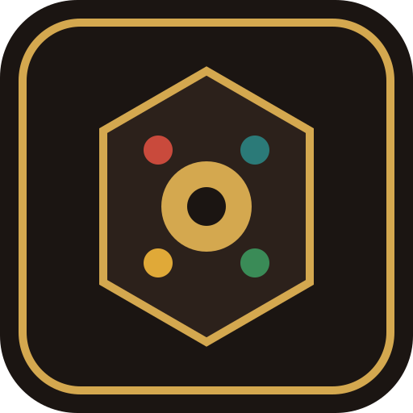
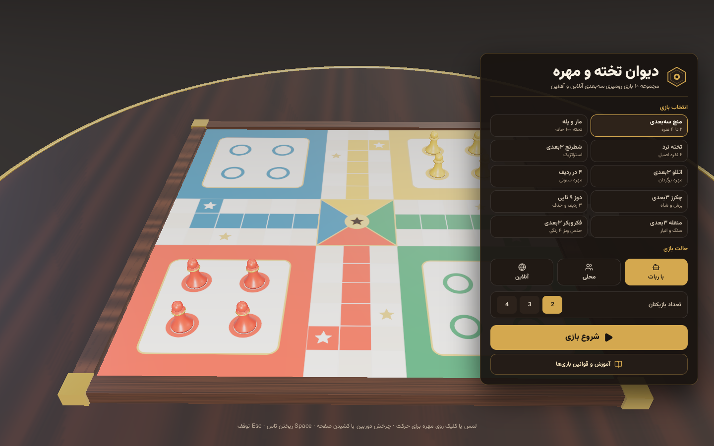
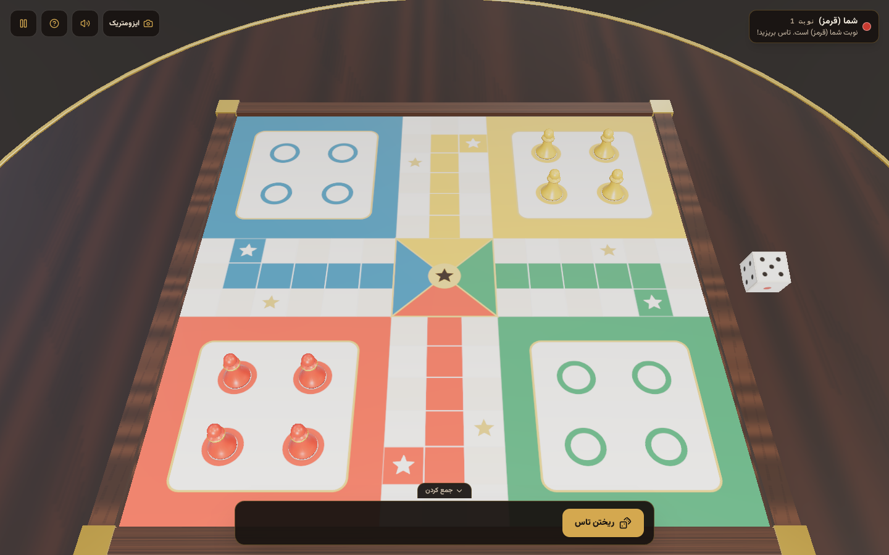
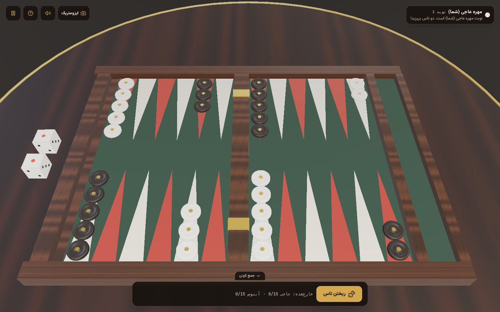
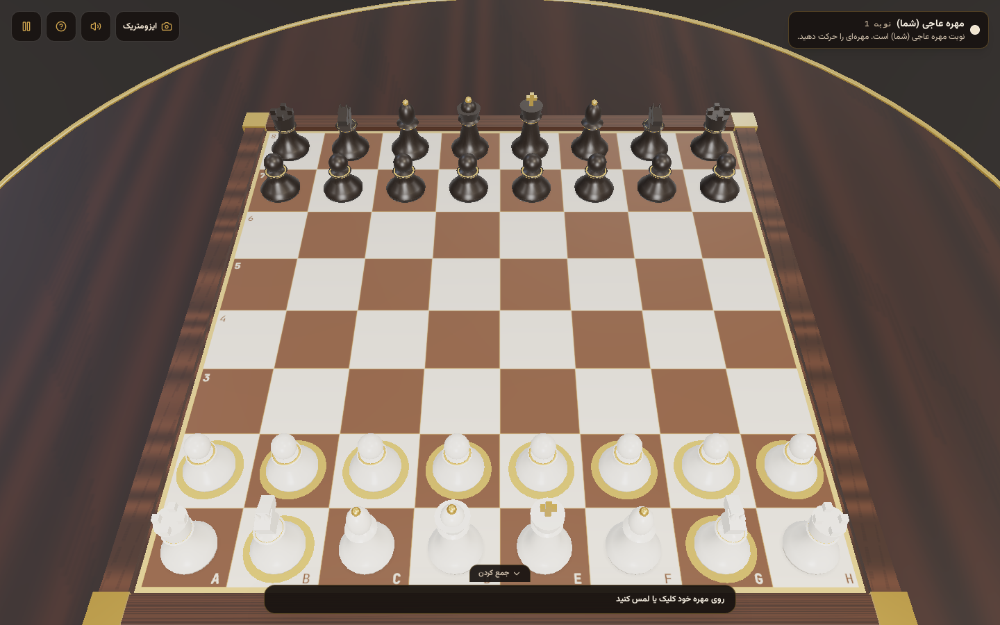
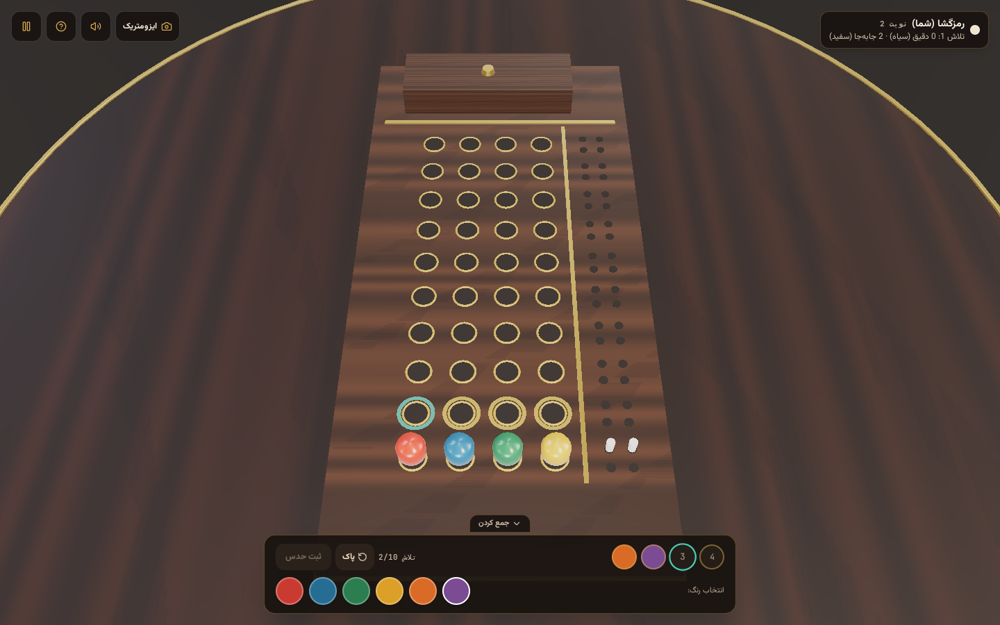
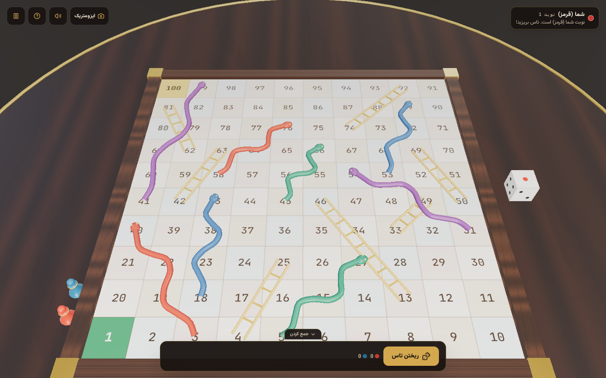
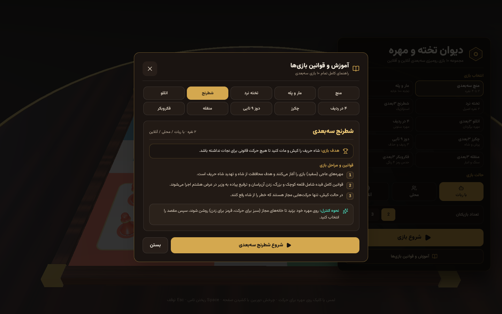
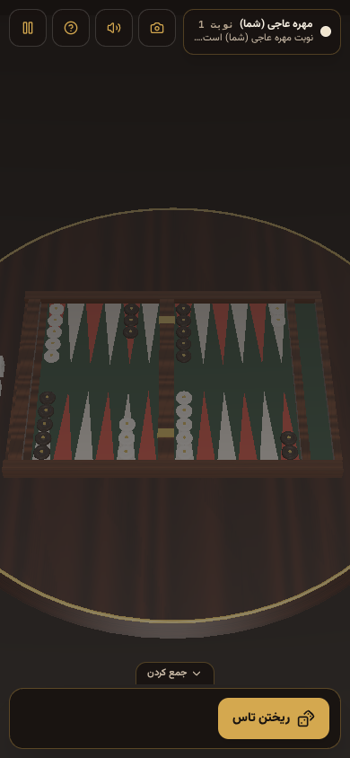

<div align="center">



# دیوان تخته و مهره | Divan 3D Tabletop

**مجموعه ۱۰ بازی رومیزی سه‌بعدی کلاسیک با پشتیبانی کامل از زبان فارسی، هوش مصنوعی، بازی محلی و چندنفره آنلاین (WebSocket) برای دسکتاپ و اندروید (PWA)**

[](https://react.dev/)
[](https://threejs.org/)
[](https://www.typescriptlang.org/)
[](https://expressjs.com/)
[](https://tailwindcss.com/)
[](#نصب-بهعنوان-اپلیکیشن-pwa)

<br />



</div>

---

## فهرست مطالب

- [معرفی پروژه](#معرفی-پروژه)
- [فهرست ۱۰ بازی سه‌بعدی](#فهرست-۱۰-بازی-سه‌بعدی)
- [ویژگی‌های کلیدی](#ویژگی‌های-کلیدی)
- [تصاویر محیط بازی](#تصاویر-محیط-بازی)
- [پشته فنی و معماری](#پشته-فنی-و-معماری)
- [نصب و اجرای محلی](#نصب-و-اجرای-محلی)
- [اجرای تست‌های واحد](#اجرای-تست‌های-واحد)
- [نصب به‌عنوان اپلیکیشن (PWA)](#نصب-به‌عنوان-اپلیکیشن-pwa)
- [کنترل‌ها و کلیدهای میانبر](#کنترل‌ها-و-کلیدهای-میانبر)

---

## معرفی پروژه

**دیوان تخته و مهره (Divan 3D Tabletop)** یک پلتفرم جامع بازی‌های رومیزی سه‌بعدی تحت وب است که روی یک میز چوبی گرد سه‌بعدی (ساخته‌شده با **Three.js**) اجرا می‌شود. تمام بازی‌ها دارای موتور قوانین مستقل و تست‌شده در سمت کلاینت و سرور هستند و هم در حالت **آفلاین (با ربات یا چندنفره محلی روی یک دستگاه)** و هم در حالت **چندنفره آنلاین بلادرنگ** با استفاده از اتاق‌های WebSocket کار می‌کنند.

---

## فهرست ۱۰ بازی سه‌بعدی

| # | نام بازی | English | تعداد بازیکن | قوانین و ویژگی‌های پیاده‌سازی‌شده | حالت‌ها |
|:-:|:---|:---|:---:|:---|:---:|
| ۱ | **منچ سه‌بعدی** | Ludo | ۲ تا ۴ نفر | خروج با عدد ۶، جایزه ۶ و قانون سه ۶ متوالی، خانه‌های امن ستاره‌دار، زدن مهره حریف و ورود دقیق به خانه مرکزی | ربات · محلی · آنلاین |
| ۲ | **مار و پله** | Snakes & Ladders | ۲ تا ۴ نفر | تخته ۱۰۰ خانه زیگزاگی، صعود خودکار از پله‌ها، سقوط از مارها، حرکت پله‌پله‌ای با انیمیشن و نیاز به عدد دقیق برای ۱۰۰ | ربات · محلی · آنلاین |
| ۳ | **تخته نرد** | Backgammon | ۲ نفر | ستاپ اصیل ۱۵ مهره، حرکت دو تاس و جفت (۴ حرکت)، زدن مهره تک، ورود اجباری از بار وسط و خارج کردن مهره‌ها (Bearing Off) | ربات · محلی · آنلاین |
| ۴ | **شطرنج ۳بعدی** | Chess | ۲ نفر | قوانین کامل FIDE شامل قلعه کوچک و بزرگ، آن‌پاسان (En Passant)، ترفیع پیاده، کیش، کیش و مات و پات | ربات · محلی · آنلاین |
| ۵ | **اتللو ۳بعدی** | Othello / Reversi | ۲ نفر | صفحه ۸×۸، نمایش خانه‌های مجاز، برگرداندن مهره‌های محاصره‌شده در ۸ جهت و واگذاری خودکار نوبت در نبود حرکت | ربات · محلی · آنلاین |
| ۶ | **۴ در ردیف** | Connect 4 | ۲ نفر | تخته ایستاده ۷×۶ سه‌بعدی، سقوط جاذبه‌ای سکه‌ها در ستون و تشخیص خط ۴تایی افقی، عمودی و مورب | ربات · محلی · آنلاین |
| ۷ | **چکرز ۳بعدی** | Checkers | ۲ نفر | حرکت مورب، پرش زنجیره‌ای و **زدن اجباری**، تبدیل مهره به **شاه تاج‌دار** در انتهای صفحه | ربات · محلی · آنلاین |
| ۸ | **دوز ۹ تایی** | Nine Men's Morris | ۲ نفر | سه فاز کامل چیدن (۹ مهره)، حرکت روی تقاطع‌ها و پرواز آزاد با ۳ مهره + تشکیل دوز ۳تایی و حذف مهره حریف | ربات · محلی · آنلاین |
| ۹ | **منقله ۳بعدی** | Mancala | ۲ نفر | کاشت پادساعت‌گرد سنگ‌ها در چاله‌ها، جایزه فرود در انبار خودی و قانون تسخیر چاله روبه‌رو | ربات · محلی · آنلاین |
| ۱۰ | **فکروبکر ۳بعدی** | Mastermind | ۲ نفر | کد ۴ رنگی از ۶ رنگ، ۱۰ ردیف تلاش، پین‌های راهنمای دقیق (سیاه) و جابه‌جا (سفید) + سپر چوبی تعیین رمز در حالت دونفره | ربات · محلی · آنلاین |

---

## ویژگی‌های کلیدی

- **رندر سه‌بعدی با Three.js**: میز چوبی، یراق‌های برنجی، مهره‌های تراش‌خورده و انیمیشن‌های روان با رندر بهینه در دسکتاپ و موبایل.
- **چندنفره آنلاین بلادرنگ**: ساخت اتاق عمومی یا خصوصی با **کد ۵ کاراکتری**، مشاهده فهرست اتاق‌های فعال (`/api/rooms`)، همگام‌سازی خودکار وضعیت بازی در سرور (`ws`) و پشتیبانی از اتصال مجدد.
- **هوش مصنوعی (AI) برای تمام بازی‌ها**: تصمیم‌گیری تاکتیکی برای تک‌تک ۱۰ بازی هم در حالت آفلاین و هم هنگام حضور ربات در اتاق آنلاین.
- **آموزش و قوانین داخلی برای همه بازی‌ها**: دسترسی مستقیم به راهنمای گام‌به‌گام و قوانین تمام ۱۰ بازی از صفحه اصلی، دکمه راهنما (`?`) در نوار بالای بازی و منوی توقف.
- **طراحی واکنش‌گرا + PWA**: بهینه‌سازی‌شده برای نمایشگرهای دسکتاپ و موبایل/اندروید با قابلیت نصب از طریق `manifest.webmanifest` و کش آفلاین (`sw.js`).
- **افکت‌های صوتی بدون فایل جانبی**: تولید صدای تاس، حرکت مهره، زدن و پیروزی به‌صورت زنده با **Web Audio API** همراه با دکمه قطع/وصل صدا.
- **زاویه دوربین پویا**: سه نمای از پیش تنظیم‌شده (**ایزومتریک**، **بالا**، **کنار**) به‌علاوه چرخش آزاد (Orbit) و بزرگ‌نمایی.

---

## تصاویر محیط بازی

<div align="center">

| منچ سه‌بعدی (Ludo) | تخته نرد سه‌بعدی (Backgammon) |
| :---: | :---: |
|  |  |

| شطرنج سه‌بعدی (Chess) | فکروبکر سه‌بعدی (Mastermind) |
| :---: | :---: |
|  |  |

| مار و پله سه‌بعدی (Snakes & Ladders) | راهنمای جامع ۱۰ بازی (Game Guide) |
| :---: | :---: |
|  |  |

</div>

<div align="center">
  <br />
  <strong>نمای واکنش‌گرا در موبایل و اندروید (۳۹۰×۸۴۴)</strong>
  <br /><br />
  
</div>

---

## پشته فنی و معماری

- **Frontend**: React 19, TypeScript, Tailwind CSS v4, Lucide Icons, Motion
- **3D Graphics**: Three.js (`OrbitControls`, raycasting تعاملی روی مهره‌ها و خانه‌ها)
- **Backend & Realtime**: Node.js, Express 4, `ws` (WebSocket Server با مدیریت Room و Server-Authoritative State)
- **Build & Tooling**: Vite 8, `tsx`, PWA Manifest + Service Worker

```text
.
├── server.ts                       # سرور Express + WebSocket (مدیریت اتاق‌های آنلاین و منطق معتبر سرور)
├── public/
│   ├── manifest.webmanifest        # تنظیمات نصب PWA برای اندروید و دسکتاپ
│   ├── sw.js                       # Service Worker برای کش و پشتیبانی آفلاین
│   └── icon.svg / icon-maskable.svg
├── src/
│   ├── App.tsx                     # کنترل وضعیت کلی برنامه، اتصال WebSocket و هماهنگی HUD / 3D
│   ├── audio/
│   │   └── soundEngine.ts          # موتور صوتی Web Audio API
│   ├── components/
│   │   ├── TitleScreen.tsx         # صفحه انتخاب بازی، حالت (ربات/محلی/آنلاین) و دکمه نصب PWA
│   │   ├── ThreeTabletopCanvas.tsx # صحنه سه‌بعدی، نورپردازی، دوربین و تشخیص کلیک روی اشیاء
│   │   ├── GameHud.tsx             # نوار وضعیت نوبت، تاس، کنترل‌های هر بازی و نوار ابزار بالا
│   │   ├── GameGuideModal.tsx      # مودال آموزش و قوانین کامل تمام ۱۰ بازی
│   │   ├── MultiplayerLobbyModal.tsx # لابی ساخت و پیوستن به اتاق‌های آنلاین
│   │   └── StatusModal.tsx         # منوی توقف و صفحه اعلام برنده
│   ├── three/
│   │   ├── tabletopBuilder.ts      # ساخت سه‌بعدی تخته‌ها و مهره‌های هر ۱۰ بازی
│   │   └── materials.ts            # بافت‌ها و متریال‌های چوب، برنج و رنگ مهره‌ها
│   └── game/
│       ├── types.ts                # تایپ‌های مشترک وضعیت بازی و پیام‌های WebSocket
│       ├── *Engine.ts              # موتور قوانین و هوش مصنوعی خالص برای هر ۱۰ بازی
│       └── *Engine.test.ts         # ۱۸ تست واحد برای صحت قوانین تمام بازی‌ها
└── docs/screenshots/               # تصاویر محیط بازی برای مستندات
```

---

## نصب و اجرای محلی

### پیش‌نیازها
- **Node.js** نسخه ۱۸ یا بالاتر
- **npm**

### ۱. دریافت پروژه و نصب وابستگی‌ها

```bash
git clone <YOUR_REPOSITORY_URL>
cd <PROJECT_DIRECTORY>
npm install
```

### ۲. تنظیم متغیرهای محیطی (اختیاری)

سرور به‌صورت پیش‌فرض روی پورت `3000` اجرا می‌شود (`PORT=3000`). در صورت نیاز می‌توانید فایل `.env` را از روی `.env.example` ایجاد کنید.

### ۳. اجرا در محیط توسعه (Development)

```bash
npm run dev
```

سپس مرورگر را در آدرس زیر باز کنید:

```text
http://localhost:3000
```

> **توجه:** اسکریپت `npm run dev` سرور Express و WebSocket (`/ws`) را همراه با Vite middleware به‌صورت یکپارچه روی پورت `3000` بالا می‌آورد.

### ۴. بیلد نهایی و اجرای Production

```bash
npm run build
NODE_ENV=production npm start
```

### ۵. بررسی تایپ‌ها (Typecheck)

```bash
npm run lint
```

---

## اجرای تست‌های واحد

تمام موتورهای بازی دارای تست‌های واحد مستقل با استفاده از `node:test` هستند:

```bash
npx tsx --test src/game/*.test.ts
```

این مجموعه ۱۸ تست را در تمام ۱۰ موتور بازی (از جمله قانون ۶ و سه ۶ متوالی در منچ، حرکت زیگزاگ در مار و پله، جفت و بار در تخته نرد، قلعه و کیش و مات در شطرنج، پرش اجباری در چکرز، تشکیل دوز در دوز ۹ تایی، کاشت منقله و ارزیابی رمز در فکروبکر) بررسی می‌کند.

---

## نصب به‌عنوان اپلیکیشن (PWA)

این پروژه از **Progressive Web App (PWA)** پشتیبانی می‌کند:

- **در اندروید (Chrome):** پس از باز کردن آدرس بازی، گزینه **«نصب نسخه اپلیکیشن»** در صفحه اصلی یا گزینه **Add to Home Screen / Install App** از منوی مرورگر را انتخاب کنید تا بازی به‌صورت تمام‌صفحه (`standalone`) اجرا شود.
- **در دسکتاپ (Chrome / Edge):** آیکون نصب در نوار آدرس مرورگر نمایش داده می‌شود.

---

## کنترل‌ها و کلیدهای میانبر

| عملکرد | دسکتاپ (ماوس و کیبورد) | موبایل / تبلت (لمسی) |
|:---|:---|:---|
| **انتخاب مهره یا خانه** | کلیک چپ روی مهره یا خانه روشن‌شده | لمس مستقیم روی صفحه سه‌بعدی |
| **چرخش زاویه دوربین** | نگه داشتن کلیک چپ و کشیدن | کشیدن با یک انگشت |
| **بزرگ‌نمایی (Zoom)** | اسکرول ماوس | نیشگون دو انگشتی (Pinch) |
| **ریختن تاس** | کلید `Space` یا دکمه «ریختن تاس» | دکمه «ریختن تاس» در پایین صفحه |
| **تغییر نمای از پیش تنظیم‌شده** | دکمه نمای دوربین (ایزومتریک / بالا / کنار) | دکمه نمای دوربین |
| **آموزش سریع بازی** | دکمه `؟` در نوار بالا | دکمه `؟` در نوار بالا |
| **منوی توقف / بستن پنجره** | کلید `Esc` یا دکمه توقف | دکمه توقف در نوار بالا |
